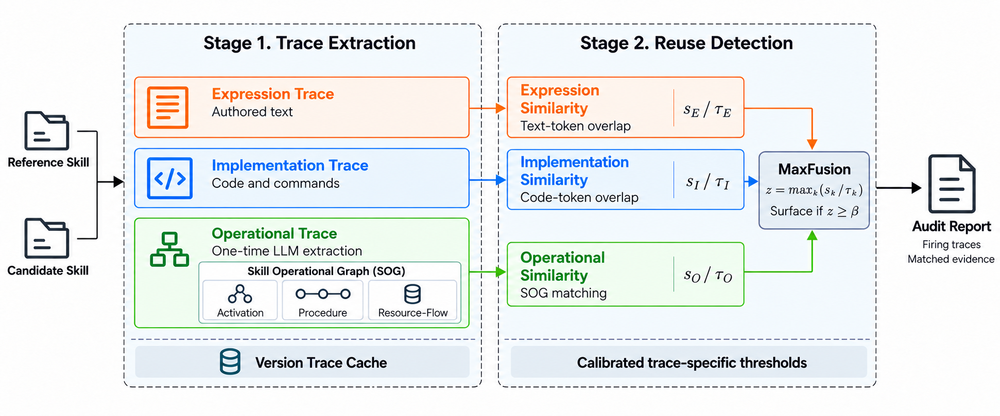

<div align="center">

# SkillTrace

### Multi-Trace Provenance Auditing for LLM-Agent Skill Reuse

**Follow preserved evidence through changes in wording, code, and operational design.**

[Method](#how-skilltrace-works) · [Results](#results-reported-in-the-paper) · [Quick start](#run-in-under-a-minute) · [Wild audit](#inspect-the-wild-audit) · [Generate variants](#generate-your-own-dataset)

**Anonymous research artifact · Python 3.10+ · Offline audit · No runtime dependencies**

</div>



## Why skill reuse needs a different audit

An agent skill combines instructions, code snippets, tools, references, and a workflow.
A derivative can rewrite its description, move code into documentation, or change its
implementation while retaining a valuable part of the original design. Whole-package
similarity can obscure that retained evidence.

SkillTrace asks **what survived the transformation, and where is the evidence?**
It separates three complementary traces and returns the trace supporting each finding.
This supports provenance review, duplicate-aware registry maintenance, and investigation
of rewritten or selectively reused skills.

| Trace | What survives | Evidence reviewers can inspect |
| :--- | :--- | :--- |
| **Expression (E)** | Authored wording, examples, trigger prose | Matched textual tokens and source files |
| **Implementation (I)** | Code, commands, API patterns, executable recipes | Matched implementation tokens and code locations |
| **Operational (O)** | Entry conditions, workflow choices, tool and artifact dependencies | Matched SOG blocks, typed relations, and source quotes |

## How SkillTrace works

**1. Register the skill.** Extract E/I substrates and an LLM-assisted Skill Operational
Graph (SOG), validate the structured result, and save a versioned trace cache.

**2. Compare cached traces.** Use token Jaccard for E/I and decomposed graph matching
for O. Repeated audits run locally without pair-specific LLM calls.

**3. Attribute the evidence.** Normalize each applicable trace by its independently
calibrated threshold. MaxFusion surfaces a pair when any normalized trace reaches
the decision bound and returns matching evidence for review.

```text
SOG = shared operational blocks
      ├── Activation:    when and where the skill starts
      ├── Procedure:     ordering, conditions, dependencies, and fallbacks
      └── Resource-Flow: what operations consume, produce, and use

O = 0.30 × BlockSim + 0.10 × ActSim + 0.40 × ProcSim + 0.20 × ResSim
SkillTrace(R, C) = max(E / τE, I / τI, O / τO) over applicable traces
Surface for review when SkillTrace(R, C) ≥ 1
```

The SOG views share block identities. This preserves the connection between a
condition, the operation it governs, and the resources that operation needs.
For example, a renamed “minimal” mode can retain the same conditional news bypass
as a “fast” mode, even when the surrounding instructions change.

**Why not compare every pair with an LLM?** SkillTrace spends LLM effort when a skill
is registered, then reuses its structured representation. A growing collection can
be audited repeatedly with deterministic local comparisons and inspectable evidence.
This removes repeated model inference from pair scoring; it does not remove the
quadratic number of pairs in an exhaustive all-pairs search.

## Results reported in the paper

**0.938 AUROC · 0.898 F1 · 73% Operational detection under full LLM rewrites**

The following values are transcribed from the paper's overall-effectiveness table.
They describe the paper evaluation, not a run on the small examples in this repository.

| Method | AUROC ↑ | Precision ↑ | Recall ↑ | F1 ↑ |
| :--- | ---: | ---: | ---: | ---: |
| RepoClone-Max | 0.841 | 0.924 | 0.679 | 0.783 |
| Expression only | 0.866 | 0.939 | 0.750 | 0.834 |
| Implementation only¹ | 0.744 | 0.935 | 0.647 | 0.765 |
| Operational only | 0.878 | 0.934 | 0.756 | 0.836 |
| Linear fusion | 0.909 | **0.973** | 0.744 | 0.843 |
| **SkillTrace-MaxFusion** | **0.938** | 0.914 | **0.883** | **0.898** |

¹ Implementation-only uses the applicable subset. Linear fusion averages applicable
normalized E/I/O scores. RepoClone-Max combines repository-level Jaccard and ssdeep
components with positive calibration thresholds.

**Where the operational view helps most.** For P3 full LLM rewrite, the paper reports
**73% detection for Operational**, versus **32% for RepoClone-Jaccard** and **31% for
Expression**; MaxFusion reaches **78%**. These are detection rates, not raw similarity
scores. The paper also reports a large-scale audit of **36,446 public skills**.

The evaluation contains **820 positive pairs** and **751 negative controls**
(551 N1 strict negatives + 200 N2 synthetic negatives). **N0 contains 100 separate
calibration pairs** and is excluded from evaluation. See [result context](docs/RESULTS.md)
for the calibration and baseline definitions.

## Run in under a minute

Python 3.10+ is sufficient. Run from the repository root; no installation, API key,
or benchmark download is needed for the supplied examples.

```bash
python3 scripts/run_demo.py
python3 -m unittest discover -s tests -v
```

The demo compares **two seeds with four variants** and writes readable JSON reports
to `outputs/demo/`. Each report includes E/I/O scores, the four Operational components,
normalized ratios, firing traces, and matching source quotes. Missing Implementation
evidence is shown as `null` and excluded from MaxFusion.

Run the repository-level baselines on one pair:

```bash
python3 scripts/compare_baselines.py \
  examples/form/seed examples/form/implementation_lift
```

Repo-Jaccard runs with the standard library. ssdeep is optional; when its Python
package is absent, the output explicitly reports `null` and `ssdeep_available: false`.

## Explore the examples

These are **small, authored demonstration packages**, with source-supported SOG
annotations prepared for inspection. They are not sampled evaluation pairs and do
not expose SkillTrace-Bench. Their annotations are supplied so readers can inspect
and run the cached-scoring path without model access.

| Seed | Variants | What to inspect |
| :--- | :--- | :--- |
| [PDF form processing](examples/form/seed/SKILL.md) | [Paraphrase](examples/form/paraphrase/SKILL.md), [implementation lift](examples/form/implementation_lift/SKILL.md) | The validate → fill → read-back sequence; identical code preserved inside a plain-text support document |
| [Market watchlist](examples/watchlist/seed/SKILL.md) | [Rewrite](examples/watchlist/rewrite/SKILL.md), [Chinese translation](examples/watchlist/translation/SKILL.md) | Conditional news bypass and persistent-condition → alert dependency across different wording |

For a concrete five-field comparison and the provenance of these fixtures, open
the [example walkthrough](docs/EXAMPLES.md). Inspect [SOG annotations](examples/annotations/)
and [versioned trace caches](examples/cache/) directly.

## Use your own skills

An explicit SOG is required at registration. The package supports either
ingestion-time LLM extraction or importing an independently prepared SOG.

```bash
# Register using an inspected annotation; this path is entirely offline.
PYTHONPATH=src python3 -m skilltrace register examples/watchlist/seed \
  --sog examples/annotations/watchlist_seed.json \
  --vocabulary config/showcase_vocabulary.json \
  --output outputs/watchlist.json

# Compare existing caches. No source package or LLM service is needed here.
PYTHONPATH=src python3 -m skilltrace audit \
  examples/cache/watchlist_seed.json examples/cache/watchlist_rewrite.json \
  --thresholds config/paper_thresholds.json \
  --output outputs/audit.json
```

For LLM extraction, frozen vocabularies, calibration on your own independent
negatives, and the exact public scoring conventions, see [METHOD.md](docs/METHOD.md).
The public demo uses the paper's reported thresholds for illustration. Calibrate
again when changing the corpus, vocabulary, or extractor configuration.

## Inspect the wild audit

**36,446 collected skill records · 204,386 scored global candidates · two observed cases**

Browse the [corpus inventory](wild/corpus.csv), its [manifest](wild/manifest.json),
and the [saved audit summary](wild/audit_summary.json). The metadata covers SkillHub,
ClawHub and SkillsRest, excludes injected controls, and does not include full skill
bodies or the benchmark. Existing source links and recorded content hashes support
snapshot identification; missing source links are left blank.

| Observed pair | Concrete retained evidence | Why it is useful |
| :--- | :--- | :--- |
| `1person` ↔ `oneperson` | Entire `SKILL.md` identical except the frontmatter name | Near-complete reuse: repository Jaccard 0.984 and Expression 0.979 both flag it |
| `local-self-healing-machine-learning` ↔ `capability-evolver` | Retained validation gate, failed-diff capture and conditional rollback | Expression is only 0.120; SOG excerpts expose the preserved operational dependencies and distinct learning hooks |

The [case walkthrough](docs/WILD_AUDIT.md) gives excerpts, exact scores, thresholds
and file hashes. These are observed overlap cases, not generated examples or findings
of unauthorized copying. Unlike the authored SOG gallery, their evidence comes from
the saved wild-audit records and inspected source snapshots.


The [grounded SOG excerpts](wild/sog/) include five-field blocks, all three views,
exact quotes and source-line pointers. They are editorial annotations of selected
operations, not full-graph extraction or a newly measured Operational detection rate.
The near-copy control also includes its two-step setup SOG; the richer second case
shows why preserving conditions, ordering and resource dependencies is informative.

## Generate your own dataset

Bring a seed skill and create source-derived variants:

```bash
python3 scripts/generate_variants.py \
  --seed examples/form/seed --output outputs/my-dataset \
  --families metadata_rewrite dilution --rng-seed 17
```

Optional LLM modes support substantial prose rewriting, natural-language translation,
and code-language port candidates. Each run saves the seed, variants and a lineage
manifest. Utility and transformation success remain **pending review** rather than
being assumed. See [generation instructions](docs/GENERATING_DATA.md) for provider
configuration, supported transformations and constructing an independent evaluation.

## Repository map

```text
src/skilltrace/       Registration, SOG validation, matching, calibration, CLI
config/              Reported thresholds and frozen showcase vocabulary
examples/            Two authored seeds, four variants, annotations, caches
scripts/             Demo, baselines, variant generation, release verification
wild/                Corpus metadata, run receipt, two observed case records
tests/               Method invariants and extraction-interface checks
docs/                Method mapping, results, examples, artifact scope
assets/              Anonymous overview figure
```

## Artifact scope

This release provides executable method code, the ingestion prompt, inspectable
examples, variant-generation code, wild inventory, two selected case records,
tests, and paper-reported aggregate comparisons. **SkillTrace-Bench,
calibration/evaluation pairs, full wild-corpus packages, full prediction files, and
human-review records are not distributed.** Consequently, the example commands
demonstrate the method but do not regenerate the paper's aggregate tables.

The release omits paper-author identities, affiliations, private endpoints and credentials;
public upstream skill identifiers are retained for traceability.
See [ARTIFACT.md](docs/ARTIFACT.md) for a concise implementation-to-paper map and
instructions for preparing a clean anonymous upload.
