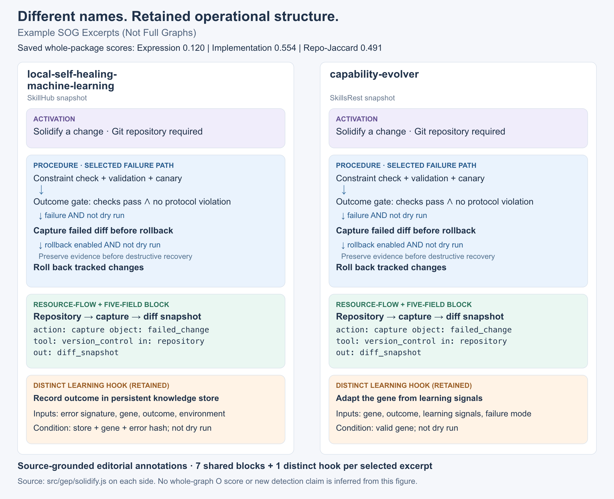

# From corpus inventory to inspectable reuse evidence

This release includes the **36,446-record wild-corpus inventory** and **two actual
observed pairs**, separate from the authored examples. Both pairs occur in the saved
global candidate scores and their underlying local file snapshots were checked when
preparing this release. They are not generated attacks or injected controls.

## What is public?

| File | Contents |
| :--- | :--- |
| [corpus.csv](../wild/corpus.csv) | Every non-sentinel corpus ID, slug, platform, collection pool, category, recorded URL, flattened-text hash and basic size metadata |
| [manifest.json](../wild/manifest.json) | Counts, field interpretation and inventory checksum |
| [audit_summary.json](../wild/audit_summary.json) | Saved run counts, thresholds, candidate buckets and source-file checksum receipts |
| [cases.json](../wild/cases.json) | Two selected score rows, short excerpts and file-level evidence hashes |
| [sog/](../wild/sog/) | Four source-grounded excerpt graphs, including exact quotes, line pointers, file hashes and a shared role vocabulary |

The recorded collection contains **26,333 SkillHub**, **6,277 ClawHub**, and
**3,836 SkillsRest** records. Cross-registry mirrors and versions remain separate
records; the count is not a claim of 36,446 independent projects. The 480 injected
controls in the original card file are excluded. Only 5,925 records have recorded
source URLs; missing links remain blank rather than being guessed. The inventory
describes the collected snapshot, not current registry availability.

The saved global run scored **204,386 candidate pairs**, not every possible pair.
The inventory and run receipt document its scope; hashes alone are not independent
proof of execution. Full packages and the full prediction file are not distributed.

## Case 1 — Near-complete textual reuse after renaming

**ClawHub `1person` ↔ ClawHub `oneperson`.** The complete `SKILL.md` snapshots are
identical after changing this single frontmatter line:

| Left snapshot | Right snapshot |
| :--- | :--- |
| `name: 1person` | `name: oneperson` |

All remaining text, including the description, workflow overview and declared
configuration, is unchanged. RepoClone-Jaccard is **0.983607** and Expression is
**0.979167**; Implementation is not applicable. Both repository and expression
evidence flag this pair. This illustrates the straightforward end of the reuse
spectrum, where a whole-package baseline is already effective.

The [left setup SOG](../wild/sog/1person.json) and
[right setup SOG](../wild/sog/oneperson.json) each capture the two declared steps:
obtain an API credential, then configure it in the environment. The credential
produced by the first operation is consumed by the second. No orchestration edges
are inferred from the marketing-level feature list. This is a near-copy control,
not evidence of an advantage unique to Operational matching.

## Case 2 — Different names, retained operational dependencies

**SkillHub `local-self-healing-machine-learning` ↔ SkillsRest `capability-evolver`.**
The first emphasizes local learning and a persistent knowledge base; the second
describes protocol-constrained agent evolution and network integration. Their names
and descriptions differ substantially. Their complete `src/gep/solidify.js` files
also differ (60,432 versus 55,919 bytes), but retain a distinctive failure-handling
workflow. The displayed graphs come from these recorded packages, not a synthetic
rewrite of one into the other.



[Editable SVG](../assets/wild-sog-comparison.svg) ·
[Left excerpt graph](../wild/sog/local-self-healing.json) ·
[Right excerpt graph](../wild/sog/capability-evolver.json)

| Saved raw similarity | Value |
| :--- | ---: |
| RepoClone-Jaccard | 0.491188 |
| Expression | 0.119861 |
| Implementation | 0.553732 |

### What survives, beyond the wording?

The selected excerpt contains seven shared five-field operational blocks and one
distinct learning hook per side. It connects three kinds of evidence:

| SOG view | Source-supported correspondence |
| :--- | :--- |
| Activation | Enter change solidification in a Git repository; reject a non-Git context |
| Procedure | Check constraints, run validation and canary checks, derive the outcome; on a non-dry-run failure, capture the diff before rollback; rollback additionally requires its enable flag |
| Resource-Flow | The repository supplies the failed diff; the captured diff survives destructive recovery; validation reports and evolution events are written to the asset log |

For example, both excerpts normalize failed-diff capture to the same block:

| Field | Left | Right |
| :--- | :--- | :--- |
| action | `capture` | `capture` |
| object_role | `failed_change` | `failed_change` |
| tool_role | `version_control` | `version_control` |
| inputs | `repository` | `repository` |
| outputs | `diff_snapshot` | `diff_snapshot` |

Its evidence is not just a shared function name. Both implementations explicitly
capture the failed mutation **before rollback destroys the diff**, under
`!dryRun && !success`; rollback separately tests `rollbackOnFailure`. The graph
preserves this condition and ordering. The source lines use `var diffSnapshot`
on the left and `const diffSnapshot` on the right; the normalized role stays the
same. Each JSON entry retains its own exact quotation and line range.

Differences are retained too: the local-learning package records an outcome keyed
by error signature into its knowledge base, whereas the other package adapts the
gene using learning signals and failure mode. They are separate unmatched blocks,
not forced into a shared generic “learn” node.

### What this demonstrates

SOG makes a retained operational mechanism inspectable despite weak Expression
overlap: not merely “both repair errors,” but the same guarded validation, evidence
preservation and rollback dependencies. The saved conservative audit thresholds
place this pair in the low-priority bucket. The excerpt is therefore a qualitative
explanation of potentially useful Operational evidence, **not a claim that the
saved run detected this pair through O**.

These are raw saved scores, not detection rates or freshly recomputed scores from
the public demonstration implementation. The SOGs are source-grounded editorial
annotations of selected local operations, not independently generated provider
outputs or complete graphs. A whole-pair O score is deliberately not inferred from
these selected fragments. The paper's controlled results remain the quantitative
evidence of detection effectiveness.

## Interpretation and verification

The two examples were selected for clarity, not to estimate prevalence. A shared
upstream source, authorized redistribution or registry mirroring may explain reuse;
neither copying direction nor a copyright violation is established. Public registry
names identify upstream artifacts, not paper authors. Source code excerpts remain
attributable to the corpus IDs and relative paths in the case records.

```bash
python3 scripts/verify_wild_inventory.py
```

This checks inventory counts, checksum, case membership and bucket totals. It cannot
recheck whole-source equality without the original snapshots. Graph schemas, roles
and references are checked against the distributed quotations; the packaging-time
check additionally confirmed every quotation against the full local source file.
The image can be regenerated as SVG with `python3 scripts/render_wild_sog.py`.
